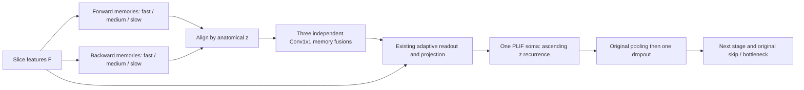

# Shared_SOMA: optional bidirectional memory fusion

`Shared_SOMA` is a third opt-in fusion architecture for `paper_unet`. The exact existing identifiers `or` and `conv_plif`, and the default `conv_plif` are unchanged. The unified experiment file is now `unet_config.yaml`. Selecting a fusion while bidirectionality is disabled retains the existing inactive-selector policy.

## Architecture and isolation

Each original encoder Conv2d/GroupNorm computes slice features F once. At the same spatial resolution, SharedSOMALIF computes independent zero-initialized forward and backward trajectories for fast/medium/slow dendritic memories. Both trajectories share the existing ordered decay parameters, spatial kernels and mixing parameters, as the original directional scans do. Their arithmetic matches the original SiLIF update order. The protected original neuron source is unchanged; an isolated recurrence in the new subclass avoids refactoring its forward method.

Backward outputs are stored at their original anatomical z indices. For each scale, an independent trainable 1x1 convolution maps `[M_forward, M_backward]` from 2C to C channels, with bias. Initial weights are `[0.5 I, 0.5 I]`, all other entries and biases zero. This gives the arithmetic mean up to FP32 rounding; the full matrices and biases remain learnable. There is no additional normalization or gate at this point.

The inherited adaptive gates take `[F_z, M_fused_z]`. Their weighted memory sum passes through the inherited memory projection and is added to F_z. One inherited PLIF soma consumes those currents in ascending z order, retaining membrane state between slices. The existing tau parameterization, ATan surrogate, detach-reset policy, and **hard reset to zero** are preserved; the conceptual subtractive-reset equation in the initial request is not substituted for the repository implementation.

The soma emits binary spikes. Original MaxPool2d follows these spikes, then standard inverted encoder dropout is applied once. During training, post-dropout features can be 0 or 1/(1-p); evaluation features remain binary. The exact same pooled, dropped tensor supplies the next encoder stage and its original decoder skip/bottleneck interface. Encoder convolution/normalization topology and decoder statements are unchanged. Only neuron construction and stage dispatch are extended.



| Mode | What is fused | Fusion resolution | Somatic recurrence per encoder stage |
|---|---|---|---|
| `or` | Binary directional spikes via maximum | After pooling | Original soma in each directional scan |
| `conv_plif` | Directional spike features via Conv1x1, GroupNorm, PLIF | After pooling | Original directional somas; extra fusion PLIF resets for every slice |
| `Shared_SOMA` | Three continuous directional memories via three Conv1x1 layers | Before pooling | One shared soma, recurrent only in ascending z |

The new mode does not execute either existing output-fusion operator, create a second directional soma, or feed fused memories back into directional recurrence. It creates no `bidirectional_fusions` output modules; new parameters are stored under `conv_block{1,2,3}.spike_neurons.memory_fusions.{0,1,2}.{weight,bias}`.

## Configuration and exact launch commands

Use `unet_config.yaml` with `snn.bidirectional: true` and `snn.bidirectional_fusion: Shared_SOMA`. There is no `mode` selector. This fusion applies independently to each encoder block whose neuron selection is `selective_multitimescale_lif`; PLIF and `MultiMemoryLinearAttentionLIF` blocks remain forward-only.

In `unet_config.yaml`, select plain SiLIF for each encoder block that should use Shared_SOMA and leave the desired decoder neuron selection in place. Enable bidirectionality and select the fusion as shown below, then launch with:

```bash
.venv/bin/python -m snn_nnunet.run_model --config unet_config.yaml
```

The settings live directly under `snn`:

```yaml
snn:
  variant: paper_unet
  bidirectional: true
  bidirectional_fusion: Shared_SOMA
  training_patch_size: [81, 128, 128]
  temporal_axis: 0
  paper_unet:
    neurons:
      model: plif
      overrides:
        conv_block1: selective_multitimescale_lif
        conv_block2: selective_multitimescale_lif
        conv_block3: selective_multitimescale_lif
      selective_readout:
        enabled: true
```

Encoder stages without plain SiLIF are skipped by the fusion, so mixed overrides and even no active SiLIF encoder are supported. Disabled adaptive readout is rejected when a Shared_SOMA stage is active. Fusion never converts PLIF or attention into plain SiLIF. OR/Conv+PLIF follow the same active-block rule. The aliases `OR`, `conv_PLIF`, `shared SOMA` and `shared_soma` normalize to the existing canonical identifiers. As with both existing bidirectional modes, the effective policy is whole-patch BPTT, `use_fptt=false`, and k from final training geometry. No intra-patch state detachment occurs. Inference context is limited to each independently reset tile.

These direct CLI examples select each mode with identical explicit encoder neuron settings and distinct new run directories (normal dataset/environment preparation still applies):

```bash
.venv/bin/python -m snn_nnunet.cli train --dataset-id 1 --fold 0 --model paper_unet --bidirectional --bidirectional-fusion or --training-patch-size 81 128 128 --paper-unet '{"neurons":{"model":"plif","overrides":{"conv_block1":"selective_multitimescale_lif","conv_block2":"selective_multitimescale_lif","conv_block3":"selective_multitimescale_lif"}}}' --run-dir runs/silif_or

.venv/bin/python -m snn_nnunet.cli train --dataset-id 1 --fold 0 --model paper_unet --bidirectional --bidirectional-fusion conv_plif --training-patch-size 81 128 128 --paper-unet '{"neurons":{"model":"plif","overrides":{"conv_block1":"selective_multitimescale_lif","conv_block2":"selective_multitimescale_lif","conv_block3":"selective_multitimescale_lif"}}}' --run-dir runs/silif_conv_plif

.venv/bin/python -m snn_nnunet.cli train --dataset-id 1 --fold 0 --model paper_unet --bidirectional --bidirectional-fusion Shared_SOMA --training-patch-size 81 128 128 --paper-unet '{"neurons":{"model":"plif","overrides":{"conv_block1":"selective_multitimescale_lif","conv_block2":"selective_multitimescale_lif","conv_block3":"selective_multitimescale_lif"}}}' --run-dir runs/silif_shared_soma
```

Native plan/config/checkpoint serialization retains the canonical fusion identifier. Existing strict architecture validation rejects changing modes on resume. Legacy missing fusion metadata still resolves to `conv_plif`. Plain SiLIF encoder parameter keys and checkpoint topology are preserved for the corresponding fusion. Old bidirectional PLIF checkpoints require the previous implementation, since PLIF stages now intentionally stay forward-only. Checkpoints are not silently converted to Shared_SOMA.

## Parameters, computation and neuronal states

All three comparisons use encoder SiLIF, decoder PLIF, encoder widths [32,64,128], decoder widths [128,128,128], and FP32. Counts are analytical for B=1, Z=81, H=W=128. One MAC means one multiply-accumulate; backward and optimizer work are excluded.

| Mode | Trainable parameters | Forward dense-equivalent convolution MACs |
|---|---:|---:|
| `or` | 1,302,348 | 444.314419 G |
| `conv_plif` | 1,345,807 | 446.352851 G |
| `Shared_SOMA` | 1,432,044 | 440.237556 G |

Shared_SOMA adds 6C²+3C parameters per encoder stage relative to OR. Per spatial site per slice, with spatial mixing enabled, its continuous dendritic/readout/fusion work is 54C+13C² MACs: two sets of three depthwise 3x3 memory convolutions, one three-gate readout, one projection, and three memory fusions. The legacy bidirectional SiLIF paths use 54C+14C² before any output-fusion cost because their gates and projection run in both directions. Continuous memory convolutions are counted as MACs, never spike/event ACs. GroupNorm, scalar memory arithmetic, bias/sigmoid functions, soma dynamics, pooling, dropout, data movement, backward and optimizer operations are excluded from convolution MAC totals; separate scalar fields are provided in the JSON ledger. Counts do not establish GPU speed, energy savings or segmentation accuracy.

| Logical states across both scans, per encoder stage | `or` | `conv_plif` | `Shared_SOMA` |
|---|---:|---:|---:|
| Dendritic memory maps | 6 | 6 | 6 |
| Directional soma voltage trajectories | 2 | 2 | 0 |
| Shared forward soma voltage trajectory | 0 | 0 | 1 |
| Slice-local fusion soma voltage state | 0 | 1 | 0 |

Each PLIF additionally caches its spike tensor. These are logical state types, not a peak-memory estimate: scans reuse live state buffers sequentially, while autograd retains graphs and memory trajectories during full BPTT. Shared_SOMA explicitly retains two aligned continuous three-scale trajectories until fusion. GPU peak memory has not been measured here.

Gradients traverse both full directional memory scans and the shared forward soma. Fusion does not detach either branch. The original `detach_reset` changes only the reset derivative, not the anatomical gradient horizon. Tests retain gradients through 81 anatomical slices. Fusion-weight gradient norms, missing gradients, nonfinite norms and consecutive zero-gradient counts are added to the inherited diagnostics for the new mode only.

## Measurements and verification

`analysis_results/shared_soma/report.json` records the complete operation ledger and CPU timing. CPU latency uses a **tiny synthetic B=1,Z=5,H=W=32 patch**, identical input and common model weights, FP32 inference mode, one CPU thread, two warmups and seven timed repetitions. The recorded median/min/max describe this shared host only; no full-size patch or MRI-volume latency is inferred. CUDA is unavailable, so GPU latency and peak GPU memory are explicitly unmeasured. Regenerate with:

```bash
.venv/bin/python -m snn_nnunet.profile_shared_soma
# On a GPU host, also measure the requested full-size synthetic patch:
.venv/bin/python -m snn_nnunet.profile_shared_soma --measure-cuda
```

The optional GPU training measurement includes forward, squared-logit loss and backward with B=2, without optimizer or dataset pipeline. It does not silently shrink an OOMing patch. CUDA measurements require a positive warmup count.

Before production changes, eight deterministic CPU references were captured: OR/Conv+PLIF × PLIF/SiLIF encoders × training/evaluation. `legacy_reference.json` contains their pre-change parameter/key, output and gradient fingerprints; `legacy_regression.json` records full-tensor comparisons with rtol=atol=0 and strict checkpoint reloads. Both output-fusion class sources and the original SiLIF source have unchanged hashes. Permanent `test_shared_soma_legacy.py` reruns the four SiLIF cases against these references. The PLIF cases are historical evidence: PLIF encoder stages now intentionally remain forward-only, verified separately in `test_paper_neuron_selection.py`. Bitwise claims are scoped to the recorded PyTorch version and CPU setup, not different hardware/library versions.

`test_shared_soma.py` checks independent memory equations and anatomical alignment, all three learnable mean-initialized fusions, adaptive gates/projection, one ascending recurrent soma, binary spikes, dropout placement, subject/exception resets, decoder interfaces, axes, whole-patch BPTT, YAML/CLI/config serialization, strict checkpoint/optimizer roundtrips, native train_step, 81-slice gradients, parameter/MAC accounting and actual convolution/soma calls.

Run all project tests with `.venv/bin/python -m pytest -q`. Final test counts and review evidence are recorded in `analysis_results/shared_soma/verification.json`.


Recorded tiny CPU latency (milliseconds per B=1 patch):

| Mode | Median ms | Min–max ms |
|---|---:|---:|
| `or` | 178.915 | 173.657–200.460 |
| `conv_plif` | 120.384 | 116.053–141.473 |
| `Shared_SOMA` | 109.488 | 104.088–131.693 |

Final verification: **70 passed, 4 pre-existing SciPy deprecation warnings**. Independent review found no Critical or Important issues; its diagnostic/argument-validation suggestions were reproduced with failing tests and resolved.

## Files

- New architecture: `snn_nnunet/shared_soma.py`.
- Existing selection/dispatch only: `snn_nnunet/paper_config.py`, `paper_unet.py`, `network_adapter.py`, `cli.py`.
- Mode-specific startup description: `snn_nnunet/trainer.py`.
- New-mode accounting: `snn_nnunet/profile_paper_unet.py`; benchmark: `snn_nnunet/profile_shared_soma.py`.
- Tests: `test_shared_soma.py`, `test_shared_soma_legacy.py`.
- Opt-in experiment: `unet_config.yaml` with `bidirectional: true`, `bidirectional_fusion: Shared_SOMA` and plain SiLIF encoder overrides.
- Documentation/evidence: this file, `analysis_results/shared_soma/*`, and local plan `docs/superpowers/plans/2026-11-05-shared-soma.md` (the existing repository ignore rule excludes docs/ from git).

The fusion operators, PLIF/surrogate implementation, encoder convolutions, decoder statements, preprocessing, loss and postprocessing remain unchanged. Stage dispatch now limits bidirectionality to active plain SiLIF encoder blocks.
